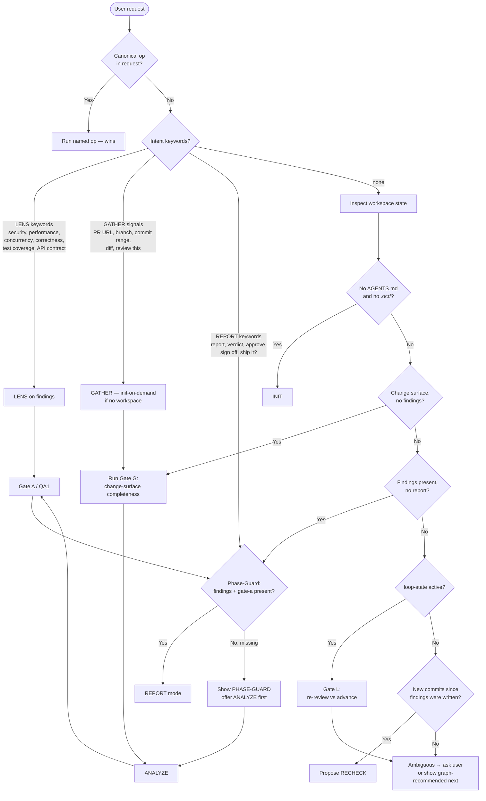

# Oh-My-CodeReview

Intelligent orchestrator for **evidence-bound code review**. Auto-detects user intent and review state, then executes the right mode — initialize, gather the change surface, analyze into findings with severity and file:line evidence, deepen through review lenses, and deliver a report with an explicit verdict.

**North star:** review findings a maintainer can trust and act on — every finding points at real code, real reasoning, and a real consequence. Not style nitpicks on a lint dump, not hallucinated line numbers.

## When to Use This Skill

- **Review** a PR, a diff, a commit range, or a working-tree change
- **Audit** a whole repository for code health, security debt, or architecture risk
- **Verify** that findings still hold after new commits (recheck)
- **Deliver** a structured review report with a verdict (PASS / PASS_WITH_ISSUES / FAIL)

**Keywords**: code review, PR review, diff review, repo audit, findings, severity, verdict, correctness, security lens, performance lens, oh-my-codereview, ocr

## Core Pipeline (Standard)

```
GATHER changes → [Gate G] → ANALYZE (findings + evidence) ⟲ LENS → [Gate A] → [Gate P] → REPORT (verdict)
```

Optional: AUDIT (whole-repo mode), RECHECK (re-verify after new commits). Default pattern: **Standard**. See `references/GRAPH.md` and `patterns/`.

Analyze and Lens form a side-cycle: when a finding's confidence is low or a risk area is unexplored, run a lens (correctness, security, performance, concurrency, API contract, test coverage), then return to analysis until the findings set is ready for the report.

## Auto-Detection Decision Tree

The agent runs **intention detection first**, then falls back to **workspace-state detection**. Canonical op names (`init`, `gather`, `analyze`, `lens`, `report`, `recheck`, `audit`, `workflow`, `qa`) **always win** over keyword routing.



**Always show a phase label** at the start of each action: `[INIT]`, `[GATHER]`, `[ANALYZE]`, `[LENS]`, `[REPORT]`, `[RECHECK]`, `[FINISHED]` (plus `[AUDIT]` when used).

## Phase-Guard: Cross-Stage Jump Protection

Before routing to a stage, **read `.ocr/tree-state.json`** and check whether the target stage is `unlocked`, `ready`, or `completed`. If `locked`, verify the required **prerequisite artifacts** exist on disk before proceeding. This prevents silent stage-skipping (e.g. user says "give me a verdict" → REPORT keyword detected → but no `findings-*.md` exists).

| Target stage | Required prerequisite artifacts                                  | Required gate JSON                                              | If missing                                      |
| ------------ | ---------------------------------------------------------------- | --------------------------------------------------------------- | ----------------------------------------------- |
| ANALYZE      | `materials/diffs/` with ≥1 change artifact + `docs/index/` entry | `gate-g.json` (change-surface completeness, run during ANALYZE) | Route to GATHER first                           |
| LENS         | `docs/review/findings-*.md`                                      | (none)                                                          | Route to ANALYZE first                          |
| REPORT       | `docs/review/findings-*.md`                                      | `gate-a.json` (pass) + `gate-p.json`                            | Route to ANALYZE → LENS → Gate A → Gate P first |
| RECHECK      | existing `findings-*.md` + a newer diff                          | (none)                                                          | Route to GATHER for the new diff first          |

**Blocking by default.** The agent must not proceed past a missing prerequisite without either (a) satisfying the prerequisites or (b) receiving an explicit user override (e.g. "I know, just give me the verdict" or "skip guard"). A general instruction like "review and approve" does **not** count as an override. When overridden, record `scenario_note: "prerequisite skipped by user override"` in the next gate JSON for auditability.

**Tree-state staleness:** after every op, update `.ocr/tree-state.json` — move completed stages to `completed`, unlock dependents, write a brief `notes` summary. A stale tree-state signals an interrupted workflow; check and refresh it at the start of any new op.

## Operation Modes

| Mode     | Op                                                               | One-line                                                                                                            | Detail                                     |
| -------- | ---------------------------------------------------------------- | ------------------------------------------------------------------------------------------------------------------- | ------------------------------------------ |
| INIT     | `init "<target>"`                                                | Bootstrap review workspace (only `AGENTS.md` + `.ocr/*.json`; no empty folders)                                     | `references/INIT/init.md`                  |
| GATHER   | `gather <pr\|diff\|range\|repo>`                                 | Change surface: diff, commits, touched files, callers/callees context, related tests, CI logs → materials + indexes | `references/GATHER/gather.md`              |
| ANALYZE  | `analyze`                                                        | Findings with severity, category, file:line evidence, and consequence; Gate G before, Gate A / QA1 after            | `references/ANALYZE/analyze.md`            |
| LENS     | `lens [name]`                                                    | Structured review pass on the findings set (never on vibes); stamps `confirmed`/`refined`/`downgraded`/`withdrawn`  | `references/LENS/lens.md`                  |
| REPORT   | `report [--format md\|html\|gh-comment] [--audience] [--strict]` | Verdict report: summary, findings ordered by severity, fix guidance, explicit verdict                               | `references/REPORT/report.md`              |
| RECHECK  | `recheck`                                                        | New commits landed: blast-radius over findings, withdraw stale, re-verify changed                                   | `references/RECHECK/recheck.md`            |
| AUDIT    | `audit [--focus]`                                                | Whole-repo mode: architecture, code health, dependency risk, security debt                                          | `references/AUDIT/audit.md`                |
| VERSION  | —                                                                | Workspace artifact versioning: tag, history, diff, backup, list                                                     | `references/VERSION/version.md`            |
| WORKFLOW | `workflow [--pattern P]`                                         | Graph-driven multi-step Standard (or other pattern)                                                                 | `references/WORKFLOW/workflow-overview.md` |
| QA       | `qa qa1\|qa2\|all\|state-check`                                  | LLM QA checklists; `state-check` reconciles disk vs tree-state                                                      | `references/GATES.md`                      |

## Confirmation Gates

Default **semi-automated** (pause for confirm). Support "no confirmations" / quick-pass. Rapid pattern skips all gates (fully-automated).

| Gate    | When                                                                                                                                                          |
| ------- | ------------------------------------------------------------------------------------------------------------------------------------------------------------- |
| G       | After GATHER: change-surface completeness — all touched files, tests, and context captured? Shows coverage report; asks user: gather more context or proceed? |
| L       | Loop pattern: re-review vs advance                                                                                                                            |
| A / QA1 | After ANALYZE findings, before unlock REPORT                                                                                                                  |
| T       | After LENS: re-gather context from surfaced gaps?                                                                                                             |
| B       | Only if a blocking-dispute resolution runs (author pushes back on a finding)                                                                                  |
| P       | Before REPORT: format / audience / strictness / severity ordering                                                                                             |
| Lenses  | Correctness → Security → Adversarial before Gate D                                                                                                            |
| D / QA2 | Before publishing REPORT                                                                                                                                      |

**Post-Step Routing Menu** (after Gate G / Gate A / LENS proceed / Gate T / Gate B): (1) Pause at each gate (default) · (2) Quick pass · (3) Continue recommended (next graph edge) · (4) Run LENS · (5) Switch pattern · (6) Stop.

## Default Paths

Paths below are **logical destinations**. Create a folder only when writing the first file into it (see `references/INIT/init.md`).

**Two surfaces.** `deliverables/` at the project root is the only public, reader-facing surface — the review report a maintainer reads lands there. `materials/`, `docs/`, and `.ocr/` are private working state and never leave the workspace.

| Artifact                   | Path (when content exists)                                                             |
| -------------------------- | -------------------------------------------------------------------------------------- |
| State (private)            | `.ocr/` (tree-state, pattern, review-state; other JSON as needed)                      |
| Change surface (private)   | `materials/{diffs,commits,context,tests,ci,failed}/` — only buckets that receive files |
| Indexes (private)          | `docs/index/` (`changes-index.json`)                                                   |
| Review artifacts (private) | `docs/review/` — findings, risk map, verdict draft, dispute notes                      |
| Audit artifacts (private)  | `docs/audit/` — audit scopes, dimension reports                                        |
| **Report (public)**        | **`deliverables/`** — exported `<target>-review-<lang>.md\|html` or gh-comment body    |
| Archive (private)          | `docs/archive/`                                                                        |

Templates: `assets/`. Patterns: `patterns/`. Full operation reference: `references/REFERENCE.md`.

## Best Practices

1. Trust auto-detection; override with canonical ops when needed
2. **Phase-Guard before every stage (blocking by default)** — read `.ocr/tree-state.json`, check prerequisites, show `[PHASE-GUARD]` if missing; never silently skip a stage
3. Never create empty directories — mkdir only as the parent of a real file write
4. **Every finding is evidence-bound** — file:line against the gathered diff or file, quoted code, reasoning chain, and a concrete consequence; a finding without evidence is withdrawn, not published
5. Use LENS (correctness / security / adversarial) before Gate A when confidence is low — in Standard, the correctness and security lenses are offered by default before the report
6. **Run Gate G after every gather batch** — show the change-surface coverage report; warn if tests or context for touched files are missing without an explicit opt-out. Prevents reviewing a diff with no surrounding code
7. Severity is a rubric, not a mood — `blocker` (must fix before merge), `major` (should fix), `minor` (nice to fix), `nit` (taste); apply `assets/templates/verdict-rubric.md` when mapping severity counts to a verdict
8. Verify claims mechanically where possible — run tests, type checks, and builds before asserting "this breaks"; if you cannot run them, say so and grade confidence down
9. Keep internal traceability private; the published report reads like a normal review comment — no gate names, no tree-state jargon
10. Write the report to disk; reply in chat with summary only
11. **Update `.ocr/tree-state.json` after every op** — move completed stages to `completed`, unlock next stages; never leave tree-state stale
12. **Recheck, do not re-review from zero** — when new commits land, diff against the gathered surface and carry forward still-valid findings

## Dependencies

- Read/write project workspace; read access to the target repository (same machine or via a gathered diff)
- Agent-authored state under `.ocr/` (tree, loop, review-state, quality-gates) — see `references/LLM-STATE.md`
- Git available for diffs, commit ranges, and blame; `gh` CLI optional for PR metadata and posting comments
- Mechanical scripts planned (not yet shipped): diff-surface collector, finding lint (fabricated line numbers, leaked jargon), report renderer

## Deep Dive

- `references/REFERENCE.md` — complete operation guide, artifact naming, evidence boundaries, tree state, troubleshooting
- `references/GRAPH.md` — pattern graphs, node ↔ artifact contracts, unlock rules, cycles
- `references/GATES.md` — gate definitions and QA checklists
- `references/LLM-STATE.md` — agent-owned state JSON schemas
- `references/GATHER/gather.md` — change-surface buckets and completeness checks
- `references/LENS/lens.md` — the six review lenses and stamp semantics
- `references/REPORT/report.md` — verdict rubric, report shape, publishing rules
